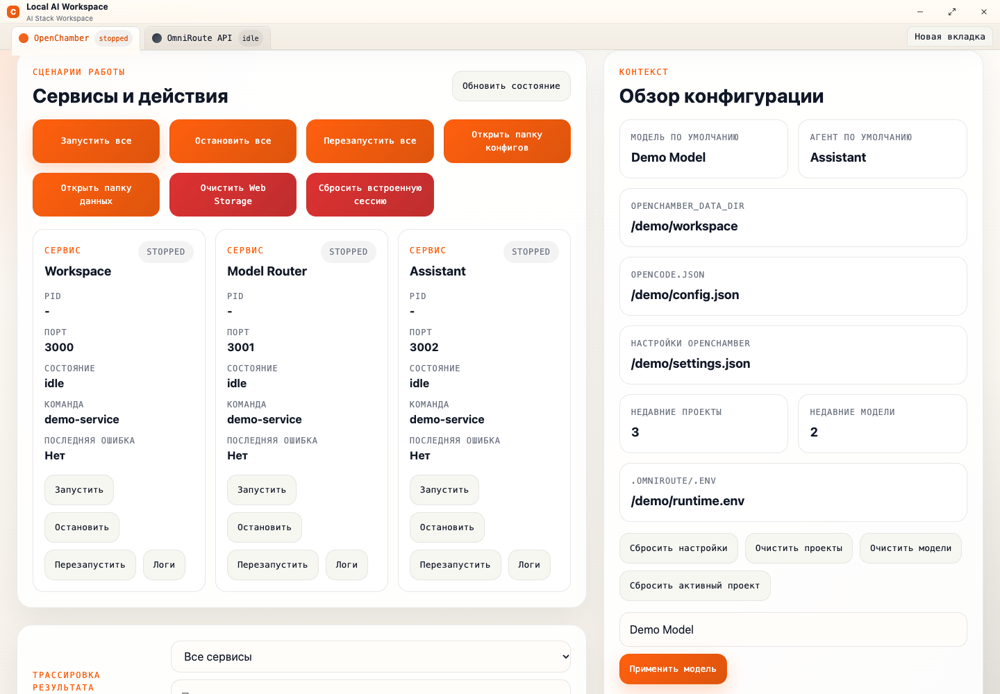
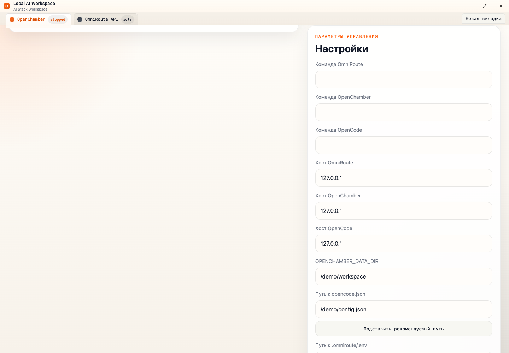

<a href="README.md">English</a> · <a href="README.ru.md">Русский</a>

<h1 align="center">Local AI Workspace</h1>

A desktop control center for local AI tools, runtime status and day-to-day diagnostics.

   

A public showcase of a private project, presenting anonymized interfaces and key workflows. Source code and internal project materials remain private.

## Key workflows

- Local service control center
- Runtime and connection status
- Diagnostics and configuration views

## Gallery

Screens are presented individually with their proportions preserved. Identifying branding, contacts and data are replaced with demo content. These previews illustrate the product and do not imply a live service is available.

### Local services

### Workspace settings

---

[Explore all projects](https://github.com/svllvsx)
